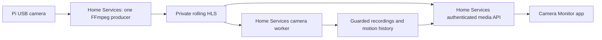

# Applications, producers, consumers, and ownership

The updated source includes a dedicated Connected Apps / Home Page token preset.
Native URL pairings in the Apple apps do not replace HTTP scopes or server tokens.
The new [QR/paste connection layer](PAIRING.md) exchanges an expiring invitation
for a scoped token, with a standalone receiving-app package and Mac management.
It is deployed with per-app receiving integrations. Opportunity Review and Casino Exit
have independent scoped provider adapters. See the verified inventory.

Current ownership after the October 25, 2026 retirement of Workspace Watcher
and Workspace Sync & Backup Utility. Home Services is the maintained server
project. It does not absorb the independent Apple apps or Better Workspace.

## Who talks to what

| App or service | Sends / writes | Reads / receives | Owner and boundary |
| --- | --- | --- | --- |
| **Files & Backups app** (iPhone/iPad/Mac) | Uploads, file operations, restore requests to `/api/v1` | Files, transfer status, snapshot history, protection status | Files & Backups owns its app and provider adapters. Direct SMB/WebDAV/SFTP/local access bypasses Home Services. |
| **Files & Backups Mac companion** (`fbbackup-agent`) | Mac Workspace snapshots **directly over SFTP** to its own restic repository; status/run reports to Home Services | Backup job configuration, destination identity; optional reporting responses | Files & Backups owns scheduling, excludes, its writer, check and restores. Source file contents do not pass through the Home Services gateway. Exactly one enabled Workspace backup job. |
| **Optional companion recovery reader** (0.4.7) | Archived-file responses and restores to fresh managed Files folders | Companion snapshots through the explicitly configured UUID-guarded `companion_recovery` root and private password file | Home Services supplies mobile recovery while the Mac sleeps. The Mac companion remains the only backup writer and owns retention. Existing primary recovery remains available. See mobile recovery. |
| **Camera Monitor app** | Live/playback session requests, arming, protection, export/deletion requests when advertised | Live streams, snapshots, recordings, motion/archive events, capability/status data | Camera Monitor owns viewing and its direct RTSP/HLS/MJPEG/ONVIF/go2rtc/Frigate clients. It is not the Pi's capture server or recorder. |
| **Pi USB camera producer** (`home-services-camera-stream`) | Private rolling HLS under `/run/workspace-camera-hls` | The camera at `/dev/video0` | Home Services owns and supervises the single FFmpeg device producer. It opens no network listener. |
| **Home Services camera worker** (`home-services-worker@camera`) | Recordings/motion events on the guarded HDD, recorder status in its own database | The producer's HLS | Always-on recording/retention continues with Camera Monitor closed. The worker does not compete for `/dev/video0`. |
| **Home Platform** (`control-plane-api`) | Authenticated storage/backup status requests | Storage contract, backup status and destination information | Home Platform owns automation, power, kiosk, device/project metadata and its database. Home Services owns the storage facts; no shared writable database. |
| **Compatibility dashboard** (`home-services-compat-dashboard`, port 8787) | Authenticated proxy requests to the Mac bridge; existing legacy API/control requests | Old camera HLS, disk/recovery status, Mac file/automation responses | Now owned by Home Services under `compat/`. Existing HTTPS URLs and legacy Camera Monitor connections remain compatible. Not the new `/api/v1` gateway. |
| **Home Services Mac bridge** (`com.zacharysturman.homeservices.macbridge`) | Fixed allowlisted commands, bounded file operations, registered Hammerspoon automation calls on the Mac | Authenticated requests from the compatibility dashboard; Mac file/automation state | Source in this project; installed outside all checkouts in `~/Library/Application Support/HomeServices/MacBridge`. Never a generic shell endpoint. Does not replace `fbbackup-agent`; the retired backup trigger is unavailable. |
| **Recovery browser + Samba** (`home-services-backup-browser`) | Read-only recovery responses over the existing SMB share | Existing repository mounted read-only at `/srv/workspace-backups` | Home Services maintains the restic mount and disk guard. Samba remains the host's separate SMB server. No writable exposure of raw repository data. |
| **Repository maintenance** (`home-services-backup-retention.timer`, `home-services-backup-check.timer`) | Existing daily retention/prune and weekly integrity check for `restic-repo` | Mount/UUID guard, unchanged retention policy and private credentials | Home Services compatibility services own these jobs. The core recovery API still never initializes/forgets/prunes. The companion repository has a different owner. |
| **Network recovery guard** (`home-services-network-guard.timer`) | Existing Wi-Fi/Tailscale recovery actions if needed | NetworkManager/default-route/Tailscale health | Home Services owns the host recovery script; NetworkManager and Tailscale remain independent system software. |
| **Notifier + ntfy** (`home-services-notifier`) | Deduplicated queued notifications to a private ntfy topic | Internal health/backup/camera/job transitions | Home Services produces notifications. The ntfy phone app delivers push notifications; Camera Monitor can configure/test/read alerts. |
| **Syncthing** | Direct configured device-to-device synchronization | Its own peer/folder state | Independent daemon, not the backup engine or a gateway upload path. Existing configuration is preserved. The missing Pi workspace SSD means production mirroring is not established merely because the Mac daemon is running. |
| **Tailscale Serve** | Routes private HTTPS and SMB traffic to existing services | Gateway/dashboard/SMB responses | Host network routing, not storage, capture or backup. Public exposure is not enabled. |
| **Better Workspace** | Local workspace/activity evidence in its own service/database | Its own filesystem watcher/project index/widgets | Owns the migrated Workspace Watcher functionality. **No current Home Services integration.** Activity tracking is not added to this server. |
| **Monthly energy reporter** (`home_services.energy`) | Private daily-Wh JSON/HTML reports; Codex automation sends the owner a monthly Gmail email | Read-only local Tapo history and verified Public Grid email/statement facts | Optional Mac runtime, separate from core workers and the disabled compatibility Tapo poller. Costs are estimated bill allocations. Hue remains unconfigured. See energy reports. |
| **Content Manager / Articles** | Mac companion uploads bounded review snapshots and acknowledges revision-checked phone edits/explicit decisions at `/api/v1/articles/review` | iPhone/iPad automatically reads Pi review copies and retains offline drafts/outbox | Core 0.4.5 / contract 1.3 adds the durable article relay. Content Manager owns native apps, Mac companion and configuration transfer; Articles owns canonical Markdown/generation/approval. The relay never publishes or replaces a publishing coordinator. Direct Mac bridge remains available. See article sync. |
| **Opportunity Discovery** | Mac `relay_companion.py` publishes read-only phone copies and applies queued, revision-checked iPhone requests at `/api/v1/opportunities/relay` | Opportunity Review iPhone app and widgets read Pi copies and queue changes when the Mac is unreachable | Contract 1.4 (first deployed as 0.4.8). Opportunity Discovery owns the app, companion and canonical SQLite. The relay never sends email; the Mac outbox sends inside its window. See opportunity relay. |

## Camera responsibility, specifically

Camera Monitor's `LocalDeviceProvider` uses AVFoundation to preview a camera
attached to the **Apple device running the app**. Its source explicitly marks
recording, history and motion unsupported, and it does not publish that camera
to other devices. Its Home Services provider requests server-created media
sessions and recordings. It cannot replace the Linux USB producer.

For an IP camera that already publishes RTSP/HLS/MJPEG, Camera Monitor can
connect directly and bypass Home Services. The Pi USB camera has no such
standalone network service. Removing the producer would stop its remote live
view and Home Services recordings. There is one device producer, not two.

## Runtime and data separation

| Component | Runtime | Private configuration/state |
| --- | --- | --- |
| Core gateway/workers/notifier | `/opt/home-services/current/venv` | `/etc/home-services/config.toml`, `/etc/home-services/secrets`, `/var/lib/home-services` |
| Migrated compatibility services | `/opt/home-services/compat/current` | `/etc/home-services/compat/{config.yaml,secrets.env}`, `/var/lib/home-services/compat/logs` |
| Mac command/file bridge | `~/Library/Application Support/HomeServices/MacBridge/current` | sibling `config.yaml`, `secrets.env`, `logs/`; private permissions |
| Mac backup companion | `~/Library/Application Support/FilesBackups/bin` | Files & Backups' separate private job/status/secret files |
| Mac status widget | `~/Applications/Home Services Status.app` and its per-user LaunchAgent | Team-scoped App Group settings and latest status snapshot. Reads the Pi and Mac agents. See Mac desktop status. |
| Optional Mac energy reporter | Repository `.dev/energy-venv` | Ignored `.dev/energy/` credentials, bill facts, reports and delivery receipts; independent of server databases |

`compat/` is a separately installed Python distribution to preserve proven
legacy endpoints/dependencies while the main API evolves. Its original
`workspace_util` module names are retained for compatibility. It has no import,
configuration, virtual-environment or service dependency on a sibling checkout.
The core API remains headless; the retained compatibility dashboard has its
existing browser UI.

See migration and rollback, backup coverage,
and [operating instructions](INSTALL.md).

## Home Page consumer — October 25, 2026

Home Page is an optional independent Mac dashboard. It reads the existing
`GET /api/v1/readiness` contract using `Home-Services-Contract: 1` and an app-specific
bearer token, and opens an explicitly configured compatibility/dashboard URL for review.
The route requires an authenticated principal, not write/admin scopes. It publishes no
commands, changes no arming/backup/storage settings, and does not replace ntfy delivery,
Camera Monitor, or Files & Backups. Home Page retains credentials in its own Keychain and
labels cached summaries stale on connection failure. No Home Services code or deployed
service was changed for this consumer; live connection setup remains explicit.
